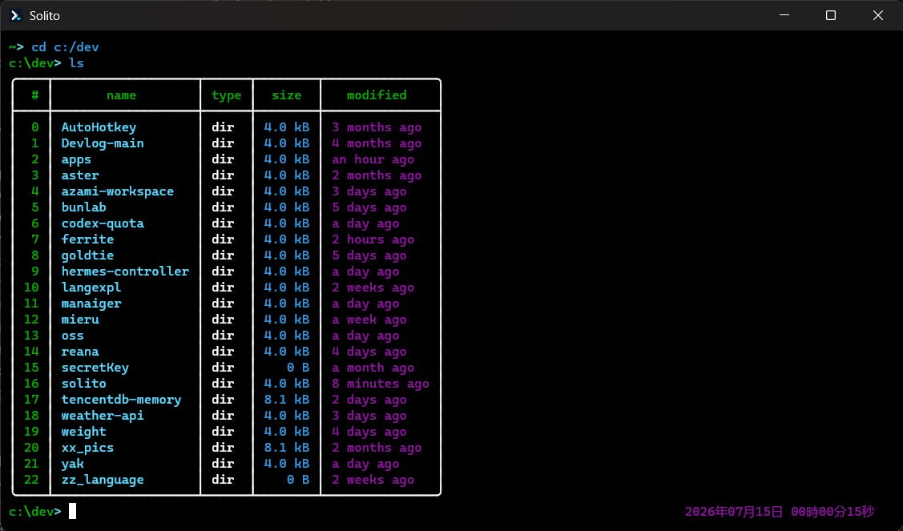

# Solito

Solito is a terminal emulator I'm building in Rust, mainly for Windows. It's a learning project: I wanted to understand what happens between typing a key and seeing a character on screen.



It has tabs, a keyboard copy mode, and settings for the font and window backdrop. Rendering runs on the GPU, with `winit` handling the window, `wgpu` and `glyphon` drawing the screen, and `portable-pty` connecting to the shell.

The compact tab strip stays visible with a single tab. Click a tab to switch;
keyboard switching also reveals the active tab when the window is narrow.
The Midnight theme pairs a deep blue-black background with a cyan-to-violet
neon accent: the active tab glows, the caret has a soft halo, and the 16 ANSI
colors are tuned for the dark background. UI and terminal font metrics stay
separate, so shell font settings keep their usual meaning.

Japanese IME input is supported: composing text appears at the terminal cursor, conversion candidates follow the active clause, and only committed text is sent to the shell. IME is disabled in keyboard copy mode so its navigation keys remain available.

Drag over terminal text to select characters, then press `Ctrl+C` to copy.
Click to clear the selection. Without a selection, `Ctrl+C` goes to the shell.
If the terminal app handles the mouse, press `Ctrl+Shift+Q` to enter copy mode,
then drag over text and press `Ctrl+C` or `y` to copy and exit.

There's still work to do on terminal compatibility. Neovim has been particularly good at finding bugs.

## Running it

```sh
cargo run --release -p solito
```

## Benchmarks

With `just` installed, this builds Solito and runs an automated Neovim session to measure CPU and memory use:

```sh
just bench
```

See [solito-bench](solito-bench/README.md) for the plain Cargo commands and other workloads. The benchmark picks its own shell for the run; your saved configuration stays as it is.

## Changing the icon

Edit [`solito/assets/solito-icon.svg`](solito/assets/solito-icon.svg), then run:

```sh
just ico
```

That regenerates the icon files and builds Solito with them.

Started on April 15, 2026.

## License

MIT. See [LICENSE](LICENSE).
